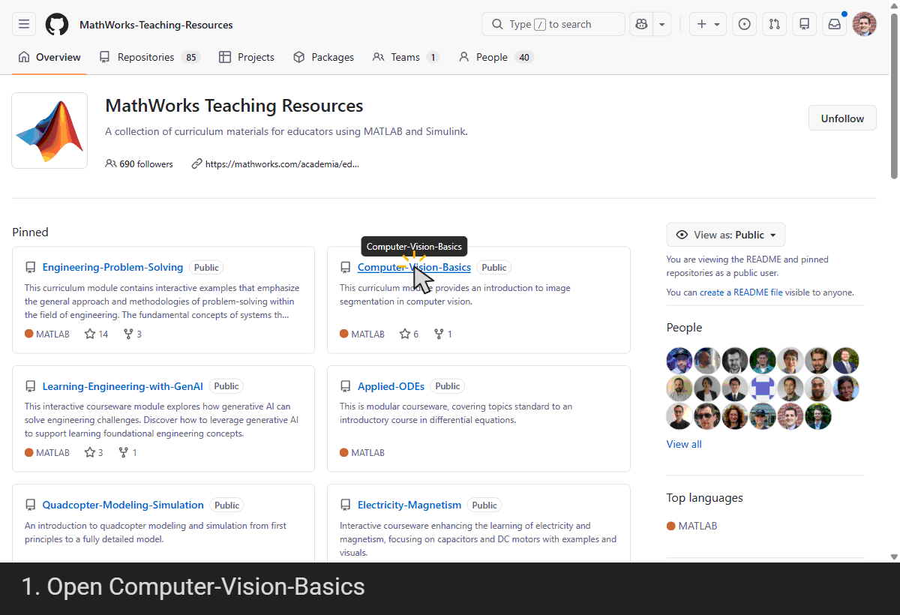
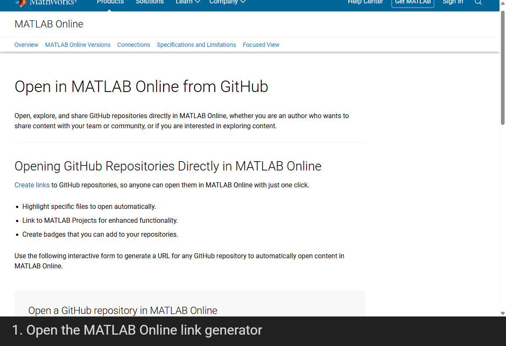

# Create Fork in GitHub

A **fork** is your own copy of a GitHub repository, which you can modify and share without changing the original. Forking maintained courseware lets you customize the materials for your course while still keeping a connection to the original repository, so you can incorporate future updates and improvements.

## Step 1: In GitHub

## Step 2: (Optional) Create an Open in MATLAB Online link for your fork

Do you want to share your fork with others? You can create an Open in MATLAB Online link (and badge! ) for your fork using the [Open in MATLAB Online link generator](https://www.mathworks.com/products/matlab-online/git.html).

Update the Open in MATLAB Online link in your root README.md to use your new link, or simply share the link directly with your students and colleagues.
