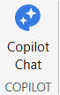
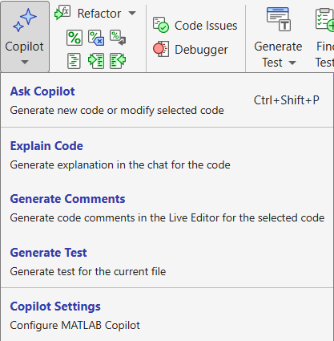
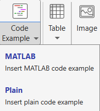
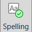
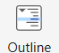

# Customize Live Scripts

This instructor guide shows how to begin adapting a course live script for a local offering while keeping the original activity reproducible.

## Find Existing Materials

| **By Academic Discipline** <br>  | **Sign up for updates of new materials** <br>   |
| :-- | :-- |
| [Mathematics](https://www.mathworks.com/matlabcentral/fileexchange/?term=tag%3A%22mathcoursewarecollection%22)  <br> [Programming](https://www.mathworks.com/matlabcentral/fileexchange/?term=tag%3A%22programmingcoursewarecollection%22) <br> [Sciences](https://www.mathworks.com/matlabcentral/fileexchange/?q=tag%3A%22sciencecoursewarecollection%22) <br> [Engineering](https://www.mathworks.com/matlabcentral/fileexchange/?q=tag%3A%22engineeringcoursewarecollection%22) <br>  | Follow the[ MathWorks Educator Content Development Team](https://www.mathworks.com/matlabcentral/profile/authors/37969341) on File Exchange <br>   <br>   |
| [General Search](https://www.mathworks.com/academia/courseware/search.html) <br>  | Get updates to [MathWorks Teaching Resources](https://github.com/MathWorks-Teaching-Resources) by following the community <br>   <br>   |

### Start With a Copy

Keep the supplied course script unchanged. Save a course\-section copy before changing prompts, parameters, examples, or hidden setup code. Use a short suffix that identifies the offering, team, or experiment.

Basic workflow:

1. Open the original `.m` live script in the MATLAB Live Editor.
2. Save a copy with a section\-specific name, such as `DriverDriveCycleLab_Fall2026.m`.

Advanced workflow:

1. Follow [Using Git](./UsingGit.md) and [Using GitHub](./UsingGitHub.md) to use version control.
2. Use [Open in MATLAB Online from GitHub](https://www.mathworks.com/products/matlab-online/git.html).

### Update Basic Details

1. Update the title, learning goals, local deliverables, and due\-date language first.
2. Run the copied script from top to bottom before sharing it with students.

### Keep Output Inline

For most teaching scripts, set output to appear inline so students see each result next to the code or activity that produced it. In the Live Editor, go to the **View** tab and choose **Output Inline**, or use . Inline output is especially helpful for plots, tables, and short calculations that support the next question.

Use output deliberately. A table or plot should help the professor explain the concept or help students check their work. Avoid long diagnostic output unless it is part of the learning goal.

```matlab
time = linspace(0,10,200);
speedCommand = 20 + 5*sin(2*pi*time/10);
plot(time,speedCommand)
title("Example Speed Command")
xlabel("Time (s)")
ylabel("Speed (m/s)")
grid on
```

### Hide Code When the Code Is Not the Lesson

Hide setup, plotting, helper functions, and long data\-loading code when students should focus on interpreting the result instead of reading implementation detail. In the Live Editor, go to the **View** tab and choose **Hide Code** or use .

Keep code visible when students must edit it, debug it, or learn the programming pattern. A useful rule is: hide code that supports the lesson, show code that is the lesson.

Add a short note before hidden setup sections so students know what the hidden code prepares. For example: `The hidden setup loads vehicle parameters and creates the baseline drive cycle.`

```matlab
baselineMass_kg = 330;
payloadMass_kg = 80;
totalMass_kg = baselineMass_kg + payloadMass_kg;
disp(totalMass_kg)
```

## Use MATLAB Copilot Thoughtfully

MATLAB Copilot can help draft explanations, create starter prompts, summarize unfamiliar code, or propose alternate examples. Treat its output as a draft that needs instructor review. If you have Copilot, it will appear in the HOME tab of the toolstrip:



When you select code in the Live Editor, MATLAB Copilot is also available on the LIVE EDITOR tab of the toolstrip:



Sample Copilot chat prompts for course customization:

- `Rewrite this activity prompt for second-year mechanical engineering students.`
- `Suggest three conceptual questions about this plot, ordered from easiest to hardest.`
- `Explain this code in two sentences without revealing the final answer.`
- `Convert this open-ended task into a checklist students can submit.`

Before accepting Copilot text or code, check technical accuracy, local terminology, assessment alignment, and whether the answer gives away graded work.

## Add Live Controls for Parameters Students Should Vary

Live controls are useful when students should explore cause and effect without editing code syntax. In the Live Editor, select a numeric value or variable assignment, then use **Insert > Control** to add a slider, drop\-down, check box, or edit field.

Choose controls for parameters with a small safe range, such as grade, temperature, gain, mass, or tire radius. Avoid controls for values that can make simulations unstable unless the limits are carefully constrained.

Example values to convert into live controls:

- `roadGrade_percent`: drop-down with values from `-5` to `20` in increments of `5`
- `ambientTemperature_degC`: slider from `0` to `50`
- `driveCycleName`: drop\-down with approved drive cycles

```matlab
roadGrade_percent = 15;
ambientTemperature_degC = 25;
driveCycleName = "eco"
```

```matlabTextOutput
driveCycleName = "eco"
```

```matlab
estimatedLoadFactor = 1 + roadGrade_percent/100 + max(ambientTemperature_degC - 25,0)/200;
disp(estimatedLoadFactor)
```

```matlabTextOutput
    1.1500
```

### Use Code Example Boxes for Reference Snippets

A code example box is useful when students need to see a command pattern but should not run it as part of the current section. Use it for optional commands, setup recipes, or examples that require local files not included in the activity.

Keep each code example short, complete, and clearly labeled. Put runnable teaching code in normal code cells; put reference\-only snippets in a code example box or text note.

In the **Insert** tab of the MATLAB toolstrip:



Example box content:

<pre>
% Copy a course script before editing it.
copyfile("DriveCycleLab.m", ...
    "DriverDriveCycleLab_Fall2026.m")

% Or just plot the standard example
t = 1:10
plot(t,t.^2)
</pre>

If the snippet changes files, warn students that it should be run only after they choose the correct destination.

## Additional Supports

1. Use the built-in spell checker on the **View** tab of the toolstrip: 
2. Use the navigation option on the **View** tab of the toolstrip to navigate between headings in the live script: 
3. [Rearrange and regroup MATLAB desktop panels](https://www.mathworks.com/help/matlab/matlab_env/change-the-desktop-layout.html) by dragging their icons.

## Customize the Learning Path

Start with changes that improve clarity for your audience before changing the model or algorithm. Typical first edits include local context, prerequisite reminders, expected submission format, and reflection questions.

Use this checklist before sharing a customized script:

- The title and learning goals match the local session.
- Output is inline where students need to interpret results.
- Hidden code does not hide anything students are expected to learn or edit.
- Live controls have safe ranges and clear units.
- Code example boxes are reference\-only and do not accidentally run.
- MATLAB Copilot\-generated text has been reviewed for technical accuracy.
- The script runs from a clean MATLAB session or includes setup instructions.

## Sharing the Customized Script

Share the `.m` live script, any required data, and any models or helper functions that the script references. If students submit their own copies, ask them to include changed parameters, screenshots or exported results, and a short note about any code they hid or modified.

Keep an instructor copy with solutions, expected outputs, and grading notes outside the student\-facing folder.

Basic workflow:

1. Share files with your students through [MATLAB Drive](https://drive.mathworks.com/) or your LMS.

Advanced workflow:

1. Follow [Using Git](./UsingGit.md) and [Using GitHub](./UsingGitHub.md) to use version control.
2. Use [Open in MATLAB Online from GitHub](https://www.mathworks.com/products/matlab-online/git.html).
