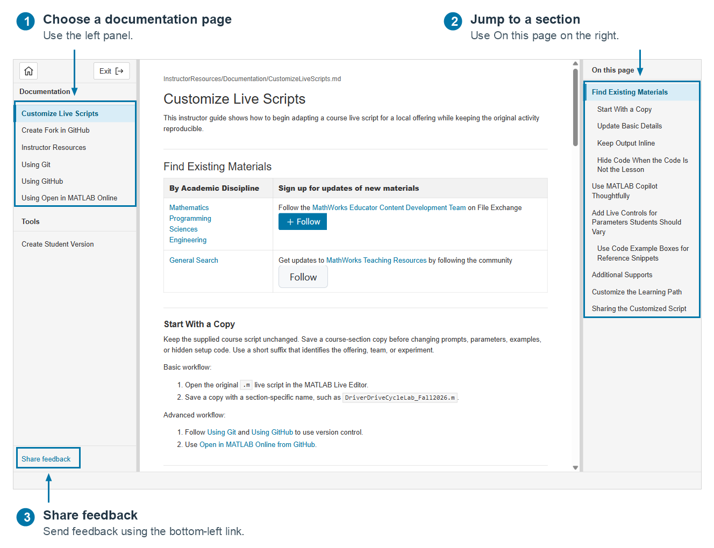
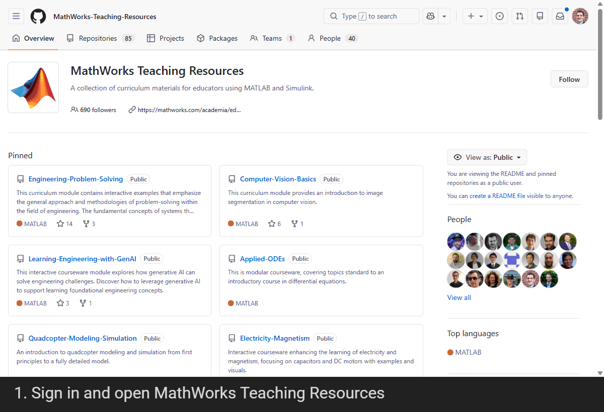
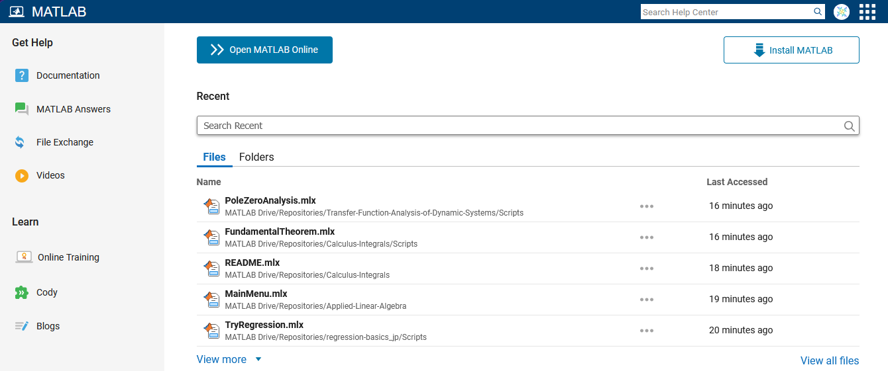
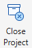
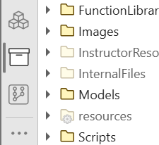
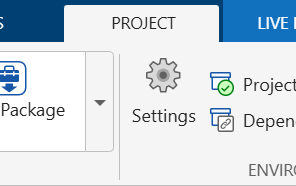
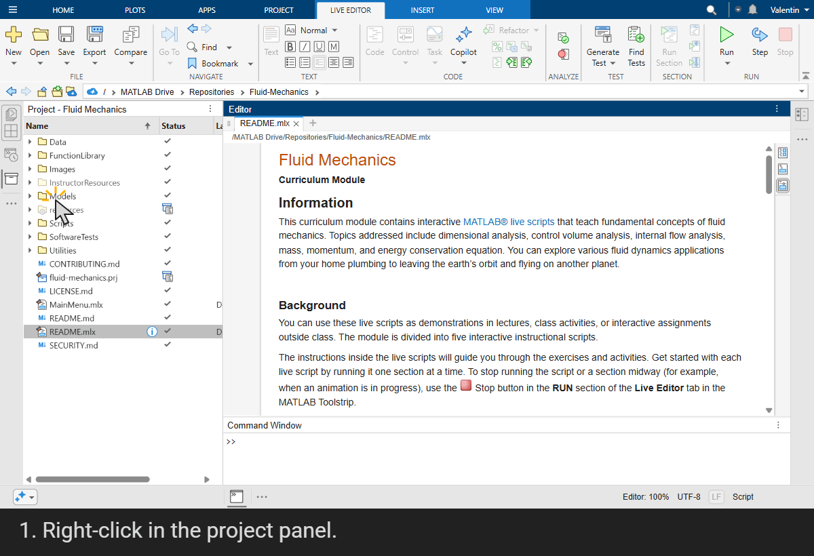
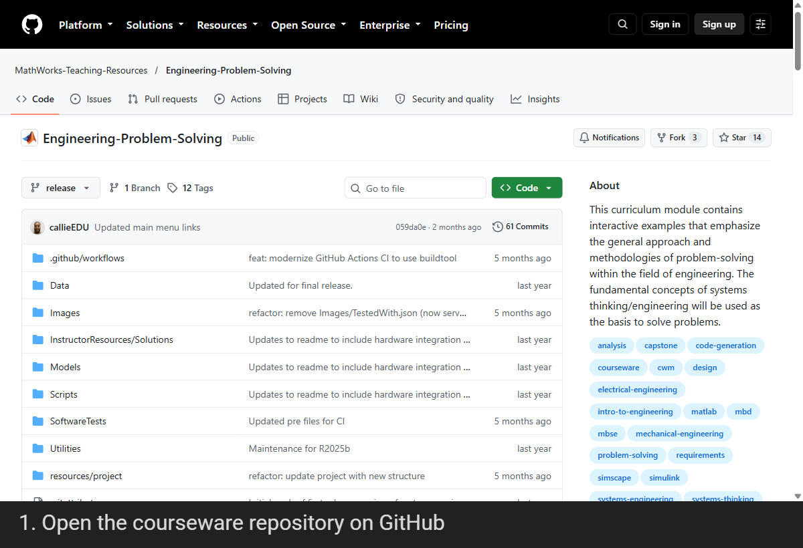

# Instructor Resources

This instructor documentation helps instructors use and adapt our courseware. You can read it on GitHub or in the **Instructor Resources** app in MATLAB. To open the app, open the courseware project in MATLAB and then click the **Instructor Resources** button.

## FAQ

### 1. About the Courseware

#### Who is creating and maintaining this content?

The [MathWorks Educator Content Development Team](https://www.mathworks.com/matlabcentral/profile/authors/37969341) creates and shares this content on GitHub and File Exchanges. This team consists of people with experience in instructional design and technical domain expertise in engineering and mathematics. The authors include two former professors who bring 20+ years of experience in academia and an engineer with aerospace industry experience. Most team members have multinational educational experience with time in North and South America, Europe, and Asia.

You can reach us:

- throughon File Exchange
- by filing an Issue on GitHub using

#### What is the goal of this courseware?

To learn more about this courseware, select **Exit**, then **Open README** in the startup app to see its purpose, prerequisites, and learning objectives in MATLAB. You can also read its root-level README on GitHub.

#### Do you have other courseware like this?

Yes, over the years we have built a growing catalog of courseware that is available on [GitHub](https://github.com/MathWorks-Teaching-Resources) and [File Exchange](https://www.mathworks.com/matlabcentral/profile/authors/37969341?detail=fileexchange).

**Tip:** Follow the [Mathworks Teaching Resources](https://github.com/MathWorks-Teaching-Resources) on GitHub for updates to any of our content. (This does require a GitHub account.)

### 2. Get and Use the Courseware

#### How do I get a copy of this content?

All courseware we maintain is available on [GitHub](https://github.com/MathWorks-Teaching-Resources) and [File Exchange](https://www.mathworks.com/matlabcentral/profile/authors/37969341?detail=fileexchange). You can access the content in several ways:

- Download it from GitHub or File Exchange.
- Clone the GitHub repository.
- Fork the GitHub repository, then clone your fork.
- Select the Open in MATLAB Online  button in the root-level [README](../../README.md).

Of these options, we recommend the following two ways to access our content:

- Clicking  from the root-level [README](../../README.md) allows you to access the courseware with a single click. When you click the button, MATLAB Online opens in a new tab and clones the repository into your MATLAB Drive. You can then start working with the content.
- A slightly more advanced approach would be to fork our GitHub repository. A **fork** is your own copy of a GitHub repository, which you can modify and share without changing the original. Forking maintained courseware lets you customize the materials for your course while still keeping a connection to the original repository, so you can incorporate future updates and improvements.

For more details on how to fork our content, see [Create Fork in GitHub](./CreateForkInGitHub.md).

#### What is MATLAB Online?

MATLAB Online is a version of MATLAB that runs directly in a web browser. It is an essential tool for both instructors and students:

- It always runs the latest version of MATLAB and Simulink with all the toolboxes covered by your license installed.
- It provides you with cloud storage, MATLAB Drive, that can be used to keep your files in sync between your MATLAB Online sessions and your local MATLAB Desktop sessions.
- When using a classroom computer, sign in to MATLAB Online to access your files and use the latest version of MATLAB. No need to bring your computer, or to bring your files on a drive.
- Students and instructors with limited computing power will have access to a stable environment to teach and learn with MATLAB.

MATLAB Online is located at [https://matlab.mathworks.com/.](https://matlab.mathworks.com) First, sign in with your MathWorks account (or create one using your university email address). This will bring you to a home page:

At the top there is an "Open MATLAB Online" button on the left and "Install MATLAB" on the right. The files list gives you a quick way to re\-open recent files that you have used. On the left is a panel with links to the documentation, online training courses, and more.

If you use an  link, that will create a copy of the requested content in your MATLAB Drive. Check for a Repositories folder or a FileExchange folder. See the process in [Using Open in MATLAB Online](./UsingOpenInMATLABOnline.md).

#### Why are you using a MATLAB Project?

Projects help us organize all the files included in this courseware. You may previously have used one large folder for all your course assets (such as scripts, live scripts, data files, and images), or one folder for each example you created. Either way, navigating all of those files can be cumbersome. A MATLAB project handles running the startup scripts, path management, and shutdown scripts for you.

MATLAB projects organize files into folders and add the required folders to the MATLAB path while the project is open. You can then run the files without navigating between folders.

For more detail, see [MATLAB Projects](https://www.mathworks.com/help/matlab/projects.html).

#### How do I use this MATLAB Project?

After downloading or cloning this courseware, double-click the root-level `.prj` file in MATLAB to load the project and set up the environment. A navigation app will open to help you find the resources you need. Use the Project panel  to inspect the files in the project.

You can close a project from the Project tab in the MATLAB toolstrip with  or from the Command Window by using

<pre>
close(currentProject())
</pre>

### 3. Customize

#### May I customize this courseware?

Yes! It is [BSD\-3 licensed](../../LICENSE.md) so you are welcome to make changes and release your own version with a citation to our original offering. Here are a few notes about [Customize Live Scripts](CustomizeLiveScripts.md) for teaching.

**Hide code note**

Although hidden code can be effective as a teaching tool, it is just a user setting. Do not count on hiding code to make your code inaccessible to your students!

#### How do I maintain the MATLAB project?

Once a project is loaded, you will have two options to maintain a project:

|||
| :-- | :-- |
|     | **The Project Panel**   This is the place where you can quickly inspect the files in the project, including whether they are on the MATLAB path (indicated by their transparency).     |
|     | **The Project Toolstrip**   This is the place where you can modify the project settings (PROJECT > Settings). This will allow you to change the project name, description, which folders are on the MATLAB path and any startup or shutdown files.     |

 **Tip:** This repository is currently using a project defined with a root level `.prj` file and `.xml` files located in the `resources` folder. You will need to keep both the `.prj` and `.xml` files to keep this project functional.

### 4. Prepare and Share with Students

#### Do you have solutions?

Yes. Instructor solution scripts are in `InstructorResources/Solutions/` and correspond to learner activities in `Scripts/`. Open the solution files directly in MATLAB using the Project panel or the Current Folder browser.

Solutions are removed when you [create a student version of this courseware](#how-do-i-create-a-student-version-of-this-courseware). Use **In another folder** when sharing materials without Git history, since a student branch retains committed instructor solutions in its history.

#### How do I create a student version of this courseware?

In the **Instructor Resources** app, open [**Create Student Version**](#student-version), also available under **Tools** in the left sidebar. This tool prepares a student version of the courseware with instructor resources and solutions removed. Follow the prompts, then review the result before sharing it with your students.

#### How do I share this courseware with my students?

For a **classroom demonstration**, the easiest way to access this content is to use the  button described in [How do I get a copy of this content?](#how-do-i-get-a-copy-of-this-content).

For **homework**, [create a student version of this courseware](#student-version) and share it with your students through [MATLAB Drive](https://drive.mathworks.com/) or [GitHub](UsingGitHub.md).

For **classroom activities** and **reference material**, we recommend sharing the courseware's Open in MATLAB Online link with your students. If you have customized the courseware, see [Create an Open in MATLAB Online link](CreateForkInGitHub.md#step-2-optional-create-an-open-in-matlab-online-link-for-your-fork) for your fork.

To share a project stored in MATLAB Drive, open [MATLAB Drive](https://drive.mathworks.com/) and create a sharing link for the project folder, as shown in the walkthrough below. Share the student version's folder when distributing homework so students receive the learner materials.

#### How do I cite this courseware?

Open the courseware's published README on GitHub or select **Exit**, then **Open README** in the startup app. Follow the courseware's File Exchange link (which may be labeled **View on File Exchange**), then scroll to **Cite As** and copy the citation into your teaching materials or publications.

The walkthrough below uses [Engineering Problem Solving](https://github.com/MathWorks-Teaching-Resources/Engineering-Problem-Solving) as an example; use the citation from the File Exchange page for the courseware you are citing.

Example citation (retrieved October 23, 2026):

> MathWorks Educator Content Development Team (2026). Engineering Problem Solving (https://github.com/MathWorks-Teaching-Resources/Engineering-Problem-Solving/releases/tag/v1.2.3), GitHub. Retrieved October 23, 2026.

### 5. Help and Feedback

#### How do I provide feedback, get help, or report an issue?

To share feedback, ask for help, or report a problem:

- Fill out our [faculty feedback form](https://forms.office.com/Pages/ResponsePage.aspx?id=ETrdmUhDaESb3eUHKx3B5mlcO9AKxC5AgMAKBg6OKuBUNTVXVlBTS0lOU0hPRExYMldGWldVQUhIRC4u), also available through **Share feedback** in the **Instructor Resources** app.
- Contact us on File Exchange using .
- Open a GitHub issue using .
