# Using Git

## Concepts and Vocabulary

This is intended as a glossary of terms that you are likely to encounter as you begin to work with Git, but you may not encounter them all at once.

**Source control**, also known as version control, is a system that manages changes to documents, computer programs, and other collections of information. Any time there are earlier versions of a document saved that you can return to, that is an example of source control. It is especially useful in collaborative environments where multiple people are working on the same project. Imagine writing a group paper where everyone can work on their sections simultaneously. Source control keeps track of each person's edits, allowing the team to see who made changes and when. It also enables you to revert to previous versions if needed, much like an advanced "undo" button. This system helps prevent conflicts and data loss, ensuring that everyone is working with the most up\-to\-date information. One popular tool for source control is Git, which is widely used in software development but can be applied to any project involving digital files.

**Git:** A common tool used for source control.

**repository:** A folder containing files and the Git history of those files.

**license:** The legal agreement lays out who can use the content in a Git repository and how they are allowed to use it. This repository is shared under a [BSD\-3 license](../../LICENSE.md).

**remote:** A shorthand way to refer to the cloud location where you are storing the shared copy of your repository. In this case, you will use a remote repository on GitHub.

**clone:** The Git term for creating the initial local copy of a Git repository.

**pull:** The action of updating your local copy of a repository to match the version stored in the remote repository using Git.

**commit:** The action of creating a saved version of your files in a Git repository. You will also be prompted to add a **commit message** where you describe the changes you have made from the previous saved version.

**branch:** The term Git uses to describe different, but related, versions of your folder and the files it contains that are being developed in parallel. This introductory walkthrough uses the main branch. The instructor toolkit's [student-version workflow](README.md#how-do-i-create-a-student-version-of-this-courseware) can create another branch.

**push**: The action of using your local repository to update the version in a remote location, such as GitHub, using Git.

**SHA**: A hexadecimal (alphanumeric) string that identifies each commit for Git, usually displayed as the last seven digits: e.g. d9ef0e5.

## Creating a Git Repository

### Locally, in your current directory

If you are working in MATLAB and would like to use Git as source control, you can turn your current directory into a local Git repository by running the command:

```matlab
gitinit
```

### From a remote repository by cloning

Step\-by\-step instructions are given in the documentation: [Clone a Git Repository](https://www.mathworks.com/help/matlab/matlab_prog/clone-git-repository.html)

For practice, you could clone the existing courseware [Programming: Structuring Code](https://github.com/MathWorks-Teaching-Resources/Programming-Structuring-Code).

Step 1. On the GitHub homepage for a repository, you should look for the green button that says "Code". Clicking on it will open a context menu where you can find the address information for cloning the repository:

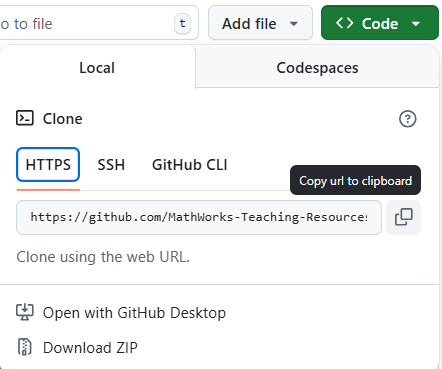

If you are going to work with the remote system regularly, it may be worth setting up an SSH key, but for now you can use the HTTPS address to clone this public repository. Use the button with overlapping squares to copy the address to your clipboard.

Step 2. Go to the HOME tab in the MATLAB tool strip and expand the New dropdown:

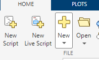

Then select Git Clone:

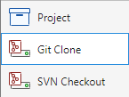

Step 3: Paste the address for the remote Git repository into the URL field and use the file browser to select a new, empty folder location to save your copy of the repository.

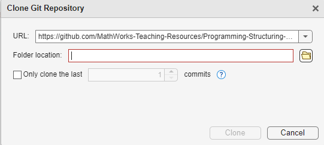

If you are worried about space, you can select the "Only clone the last 1 commits" checkbox. Then click Clone.

## Committing to a Git Repository from MATLAB

The process of telling Git that you want to save the current version for future reference is called "committing" and the description of the current state and/or changes that have been made from the previous committed version is called a "commit message".

First, ensure that you have defined appropriate credentials in MATLAB Settings under Source Control:

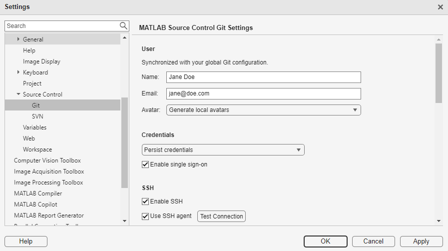

### If you are working in R2025a or later

You can use the Source Control panel  to identify and commit changes to your files.

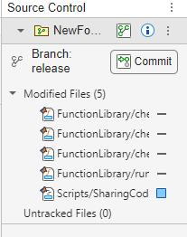

Clicking the Commit button will open up a Commit dialog like this one:

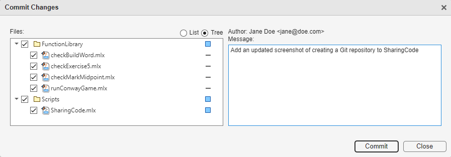

Enter the commit message in the box on the right, here it is "Add an updated screenshot of creating a Git repository to SharingCode", then click Commit. You will not be able to commit without writing a commit message as it is part of the required structure for Git.

### If you are working in R2024b or earlier

To use Git from the tool strip, you must format your work as a project.

Go to the HOME tab in the MATLAB tool strip and expand the New dropdown:


Then select Project and create a new project from your current folder:

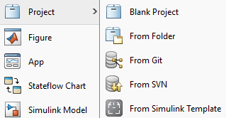

Then in the Project tab, you can find the Source Control section,

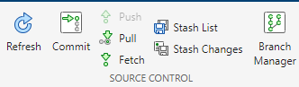

including Commit.

**Pro\-Tip:** If you have initialized a git repository, but you see 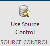 in the Project tab, select it. Then select "Add Project to Source Control"

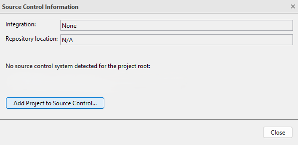

And select Convert:

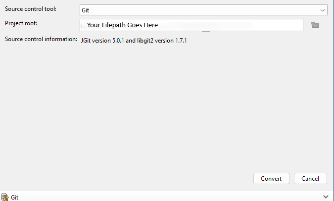

## Pulling From a Remote Repository

Pulling from a remote repository updates the state of your local repository with any changes that have been made to the remote one. If you are the only person working on a project, this is not likely to happen a lot but you may still make changes, such as edits to the README, in the remote version. If you are working with other people, this is a great way to share code and updates.

In a repository that you have cloned, you will immediately be able to pull from the Source Control section


Or within the Source Control panel:

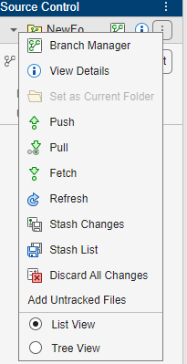

## Pushing To a Remote Repository

If you have appropriate permissions to add your work to a remote repository, you can also use the Source Control section of the Project toolstrip to **Push** which will update the remote repository with the local commits that you have made. It is always best practice, even when working alone, to **Pull** immediately before you **Push**, just to make sure you know what you are trying to add to.

## Working With Collaborators: Branching and Merging

To keep a clean, common copy of a joint project, individual collaborators will usually create their own branch to work on and periodically merge work that they wish to share back into the main branch. Merging is the process of choosing which pieces of conflicting work generated by different contributors will be combined to create the saved copy. Detailed instructions can be found in the documentation for [branches](https://www.mathworks.com/help/matlab/matlab_prog/create-manage-and-merge-git-branches.html) and [merging](https://www.mathworks.com/help/matlab/matlab_prog/resolve-git-conflicts-in-matlab.html).
