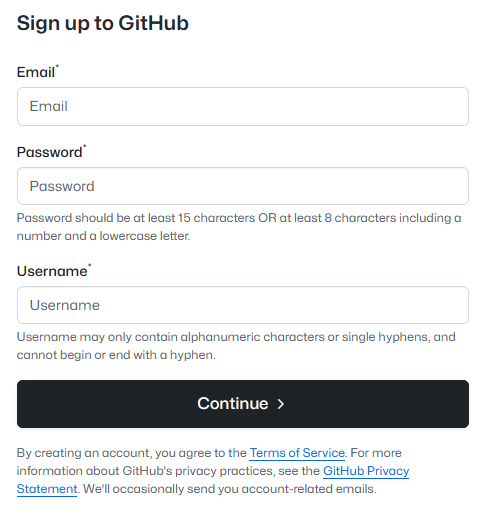
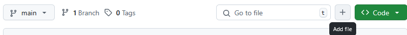
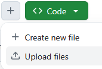
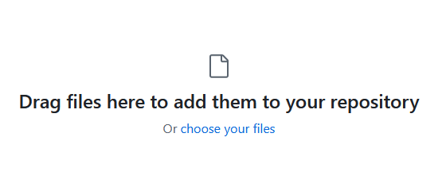
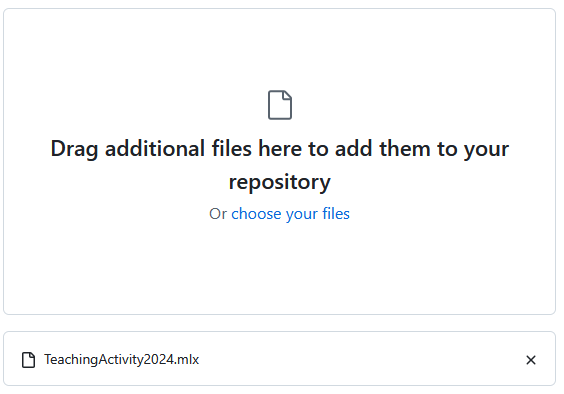
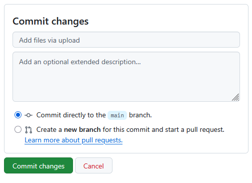
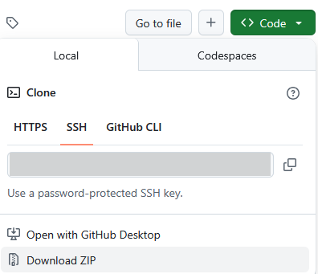

# Using GitHub

## Section 1: Create a GitHub account

Visit [GitHub.com](https://github.com/) and select the "Sign up" button in the top right.

### Create a username and password

### Set up two\-factor authentication (2FA)

To make sure that only you can access your account, GitHub now requires two\-factor authentication for all contributors. This means you will need both your username and password, but also a time\-based one\-time password application (frequently used as a phone app) to log in. The instructions for setting up your 2FA can be found [here](<https://docs.github.com/en/authentication/securing-your-account-with-two-factor-authentication-2fa/configuring-two-factor-authentication#configuring-two-factor-authentication-using-a-totp-app>).

## Section 2: Post your materials

The steps below publish your files in a new repository. To customize an existing courseware repository while retaining its connection to the original, follow [Create Fork in GitHub](CreateForkInGitHub.md). To publish a student branch created by the toolkit, review and commit its changes, then push that branch to a repository you control using [Using Git](UsingGit.md#pushing-to-a-remote-repository). The toolkit does not create a GitHub repository or push changes. A student branch retains Git history, including committed instructor materials; use a folder export when students should receive files without that history.

Create a new repository: [https://github.com/new](https://github.com/new)

1. Give it a useful name that uses dashes in place of spaces such as MATLAB\-Teaching\-Forum\-Materials
2. Select "Public" so that anyone will be able to see your materials
3. You will add the README you have written here, so you can leave the "Add a README file" unchecked
4. .gitignore is a file that tells Git not to save certain files. You don't need to include one.
5. For new teaching files you authored, we suggest the [BSD\-2 license](https://opensource.org/license/bsd-2-clause) with yourself as the copyright holder. When sharing customized courseware or a student export, retain its existing `LICENSE.md` and copyright notices.
6. Add your teaching files to your repository

Click on the "Add file" button to open the options:

Then select "Upload files"

You can drag and drop your files into the target region, or use a file selector to locate the files you want to upload:

Files that you add will appear below this, e.g.,

When you are done adding files, scroll down the page to write your commit message. If you are happy with the suggested message, "Add files via upload" you can immediately click "Commit changes".

## Section 3: Sharing your Teaching Activity

Now that your materials are posted on GitHub, you can share them with the world!

To download a copy of your repository, anyone who visits your GitHub repository page can select the green Code button, then "Download ZIP".

## Glossary: Concepts and Vocabulary

This is intended as a glossary of terms that you are likely to encounter as you work through publishing your work on GitHub, approximately ordered by the likelihood that you will encounter it.

**Source control**, also known as version control, is a system that manages changes to documents, computer programs, and other collections of information. Any time there are earlier versions of a document saved that you can return to, that is an example of source control. It is especially useful in collaborative environments where multiple people are working on the same project. Imagine writing a group paper where everyone can work on their sections simultaneously. Source control keeps track of each person's edits, allowing the team to see who made changes and when. It also enables you to revert to previous versions if needed, much like an advanced "undo" button. This system helps prevent conflicts and data loss, ensuring that everyone is working with the most up\-to\-date information. One popular tool for source control is Git, which is widely used in software development but can be applied to any project involving digital files.

**Git:** A common tool used for source control.

**repository:** A folder containing files and the Git history of those files.

**README**: A special file in the repository that will be the initial page that is shown on GitHub.

**license:** The legal agreement lays out who can use the content that you are sharing and how they are allowed to use it. This repository is shared under a [BSD\-3 license](../../LICENSE.md).

**commit:** The action of creating a saved version of your files in a Git repository. You will also be prompted to add a **commit message** where you describe the changes you have made from the previous saved version.

**branch:** The term Git uses to describe different, but related, versions of your folder and the files it contains that are being developed in parallel. This introductory walkthrough uses the main branch. The instructor toolkit's [student-version workflow](README.md#how-do-i-create-a-student-version-of-this-courseware) can create another branch.

**remote:** A shorthand way to refer to the cloud location where you are storing the shared copy of your repository. In this case, you will set up a remote repository on GitHub.
